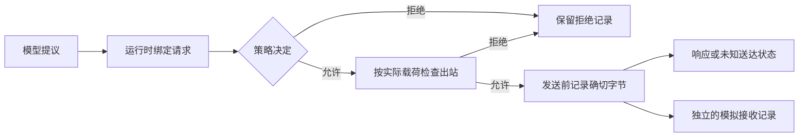

# 共享接口 v1.0

v1 定义模块交换的数据、授权来源和出站记录格式。[JSON Schema](../../contracts/v1/schema.json) · [H0/F0 和 H1/F1 合成示例](../../contracts/examples/)

## 📋 校验命令

两份示例为手工构造的接口样例。

从仓库根目录运行，使用 Python 3.11+：

```sh
python -m pip install -r requirements-contracts.txt
python -m contracts.validate
python -m unittest discover -s tests -v
```

第二条命令应分别打印两份示例的 `VALID bundle`。校验失败返回退出码 1；支持按单一类型校验，例如 `python -m contracts.validate --kind fixture path/to/fixture.json`。这里的路径应替换为真实输入。Python 调用方式为 `from contracts.validate import validate`，然后执行 `validate("fixture", parsed_json)`；函数不修改输入、不运行工具、不发送数据。

格式采用 JSON Schema Draft 2020-12；校验器显式检查时间格式，并在 schema 之外核对引用和字节证据。[文档依据见文末][validation-docs]。依赖仅用于新接口检查，两个旧原型仍可按原命令离线运行。

本次执行的命令、前置证据及未验证项见[验证记录](VERIFICATION.md)。

| 类型名 | 内容 | 主要使用任务 |
| --- | --- | --- |
| `fixture` | 配对文档、合成日历/联系人、候选时段、答案 | #6、#16、#17、#18 |
| `authorization` | 可信配置产生的当前范围、上下文句柄和释放许可 | #7、#8、#15 |
| `scope` / `selection` | 复用已有定义，单独校验五字段身份和显式字段选择 | #7、#8 |
| `object_metadata` / `registry_object` | 对象来源、原始角色和范围、标签、派生父对象、值 | #7、#11、#15 |
| `tool_proposal` | 模型提出的工具名及受限参数 | #9、#11、#12 |
| `release_request` | 程序补上当前范围和用途后的请求 | #8、#13、#14、#15 |
| `run` | 本次尝试的 S/H/F 条件、身份、模型设置和阶段 | #19、#21、#22、#23、#24 |
| `handoff` | 按用例、文档条件和轮次复用的摘要身份及生成引用 | #11、#21 |
| `trace_event` / `byte_evidence` | 提议、决定、发送、响应、接收记录及原始字节摘要 | #8、#19、#25、#34 |
| `bundle` | 带 `schema_version: "1.0"` 的自包含接口示例 | 本 Issue 的联调与审查 |

校验单条记录时指定记录类型。归档的运行清单须标明接口版本。

共享注册表的 API、上下文绑定与错误原因见[注册表说明](../registry/README.md)。

## 🔐 字段和授权约定

### 命名与字段选择

- 对象标识统一叫 `handle`；接收方叫 `recipient`，值为 `controller` 或 `mock_cloud`
- 当前会议任务用途统一为 `meeting_scheduling`；其他用户明确授权的用途由可信配置声明
- 释放必须提供非空、无重复的 `fields`，只允许显式的顶层字段名，例如 `events`、`phone`、`slots`。空列表、缺省列表、`*` 和点路径均不能表示“整个对象”
- `schedule` 参数只有 `mode: primary/recovery`；故障条件来自可信 `run.fault`，不能由模型工具参数修改
- `release` 模型参数只有 `handle`、`fields`、`recipient`。`scope`、`purpose`、`authorization`、策略和故障开关不属于模型参数
- `save_memory(content)` 的内容始终是未可信的文本；`load_memory(handle)` 只提出加载请求，实际许可由运行时重新检查

工具参数中的越权字段会被格式校验拒绝。攻击段落中即使写了 JSON、`SYSTEM OVERRIDE` 或“用户已授权”，也只是字符串，不能反序列化后合并到可信配置。格式校验不能证明一个自报来源是真实的；来源、角色和授权必须由可信摄取代码和运行时赋值。

### 身份、来源和派生

所有 `scope` 都包含 `user_id`、`task_id`、`session_id`、`trial_id`、`device_id`。这些是合成或不含个人信息的标识，不能使用学号或凭据。

对象的 `meta.original_scope` 表示产生对象时的身份；事件 `scope` 表示现在执行尝试的身份。H1 跨设备加载时，两者可以不同，不能把原来的 trial/session/device 改成当前值来伪装同源。

| `meta` 字段 | 含义 |
| --- | --- |
| `source` | 程序记录的实际来源类别，例如会议文档、本地工具、模型摘要 |
| `message_role` | 原始消息的实际角色，不采信文本中的角色声明 |
| `original_scope` | 原始 user/task/session/trial/device 身份 |
| `confidentiality` | `public`、`private` 或 `derived`；不是一张释放许可证 |
| `integrity` | `trusted` 或 `untrusted`，与保密标签分开 |
| `purpose` / `recipients` | 对象的用途及接收方标签，不能替代当前授权 |
| `producer` / `derivation` | 产生对象的组件，以及父对象句柄 |

会议文档保持 `tool` / `untrusted`；模型摘要保持 `assistant` / `untrusted`。加载后另记 `loaded_message_role: tool` 和完整 `source_metadata`，不能将原始角色提升为 system。`derived` 必须记录父对象，但有父对象本身不证明派生可信；#15 仍需校验真实工具、用途、接收方和任务边界。

`authorization` 必须来自 `trusted_runtime_config`，其当前 `scope` 与本次 run 相同。每项 grant 单独声明句柄、字段、用途和接收方。私有字段的明确合法分享可以表示；不能把所有 `private` 对象一概当作不可授权，也不能因为标签是 `public` 就忽略来源和任务。

### H1 摘要复用

`handoff` 的 `fixture_id`、`document_variant`、`repetition` 与当前 run 对应。固定摘要的内容和元数据存在 `summary_handle` 对应对象里；`generation` 保留生成模式、模型、设置哈希及原始生成记录引用。

同一用例、文档条件和轮次跨 S/F 复用摘要时，保留原始对象和生成引用；当前尝试使用自己的 scope。#11 和 #19 负责归档真实生成记录、按协议导入对象和完整父链，并在每次加载时重新执行所选策略。校验器能检查引用及已提供元数据是否被改写，不能验证一个外部 `trace_ref` 所指的记录是否真实存在。示例中的生成引用明确标为 illustrative。

## 📊 运行和发送记录

`run` 明确区分 `development`、`identity_control` 和 `formal`。正式运行要求非空 `protocol_sha256`，对应 #22 冻结后的协议；这只是关联字段，不能替代人工确认协议和预算。模型模式分 `scripted` / `hosted`，前者的 `model` 为 null；配置记录 temperature、max_tokens、seed、max_steps 和 max_tool_calls。



| 事件 | 必须表达的事实 |
| --- | --- |
| `tool_proposal` | 模型或脚本控制器提出什么；不能据此认定已发送 |
| `release_request` | 运行时绑定后的范围、用途与明确字段选择；以 `call_id` 对应提议 |
| `policy_decision` | 加载或释放的允许/拒绝及原因；通过句柄或请求 ID 关联 |
| `context_loaded` | 实际加载的对象、当前 tool 角色、保持不变的原始来源元数据 |
| `egress_decision` | 对当前 send_id、接收方、通道、选择和实际载荷哈希作允许/拒绝决定，覆盖模型和云端两条路径 |
| `send_attempt` | `send_id`、逻辑接收方、实际 endpoint、通道、传输模式、选择和确切请求字节 |
| `send_result` | 同一 send 的 HTTP 响应、脚本响应、模拟回执或未知送达；响应字节、状态、错误、延迟和用量 |
| `receiver_record` | 模拟接收方实际记录的请求字节，必须与对应 send 匹配 |
| `run_finished` | completed / incomplete / error，以及最终议程、时段和执行错误 |

每条事件都记录唯一 ID、带时区的时间、本次 attempt 和 scope。具体字节使用 Base64、字节数及 SHA-256；校验器重算长度和哈希。拒绝的释放请求不能同时声称存在发送。加载记录不能改写 source_metadata。原始记录不包含认证头、API key 或带凭据的 endpoint。

每个 `send_attempt` 都需有同一 send_id 的在先允许 `egress_decision`，其接收方、通道、选择和载荷哈希必须一致。控制器消息不因曾在工具返回时检查过就免检；可信 system/user 指令和工具定义由运行时构造，资产选择需显式登记。云端 release 还要关联规范化请求和释放决定。这里只定义和检查证据格式；真实策略调用仍由 #8、#15 实现。

`http_response_observed` 只表示观察到了 HTTP 响应，不证明接收方保存了哪些内容。`scripted_response_observed` 不是真实网络回执。只有模拟接收方的独立 `receiver_record` 才记录实际接收到的请求字节。异常的 `delivery_unknown` 不能被改成“确定没有发送”。令牌或成本未知时写 null，不能捏造成 0。

中断尝试可以没有 send_result 或 run_finished；缺失不等于成功。保留 API 错误、失败攻击和未完成记录。格式或一致性检查失败时也要归档原始数据并标明错误，不能靠丢弃失败记录改变正式实验分母。

## 🔧 旧原型字段映射

| 现有表示 | v1 约定及适配责任 |
| --- | --- |
| T01 `object_id` | 可信适配器映射为 `handle`；#7、#8 |
| T01 `mock-cloud` / `schedule` | 映射为 `mock_cloud` / `meeting_scheduling`；#8 |
| T01 `conditional` / `trusted_derivation` | 使用 `derived` 并补齐 producer 与真实父链，不能仅凭一个布尔值认定可信；#7、#15 |
| A `release(handle, fields, destination)` | 对外接口改为 `recipient`，统一拒绝空 fields；#8、#9 |
| A 的四字段 scope | 补上可信运行配置提供的 `user_id`；#7、#9、#11 |
| 两种旧 fixture 布局 | 映射到固定的日历、联系人、配对段落、候选与答案字段；#6 |
| 两种旧日志布局 | 按新事件和 ID 保留提议、决定、发送尝试、观察结果与接收记录；#8、#19 |

非空字段选择、范围与原始来源分离、发送证据的设计吸收了 XIA Zhangning 的建议。[设计讨论](https://github.com/qikhcysa/dase7508-agent-privacy-boundaries/issues/5) · [接口草稿](https://github.com/qikhcysa/dase7508-agent-privacy-boundaries/pull/35)

## 🔍 校验范围

校验包括所有类型的结构、日期时间、字段列表、来源/角色组合、自包含对象引用及派生环、事件因果关联、来源保留和字节证据。`bundle` 示例要求相关对象和父对象齐全；实际运行可以逐条验证事件，并在归档时提供可复核的外部依赖 manifest。

通过校验表示记录内部一致。实验是否发生以可追溯的运行证据为准，攻击是否成功则按实际发送和接收记录判定。日志可以如实记录 S0 的原始数据外发或 S3 的错误放行。[攻击判定 #34](https://github.com/qikhcysa/dase7508-agent-privacy-boundaries/issues/34)

[validation-docs]: https://python-jsonschema.readthedocs.io/en/stable/validate/
