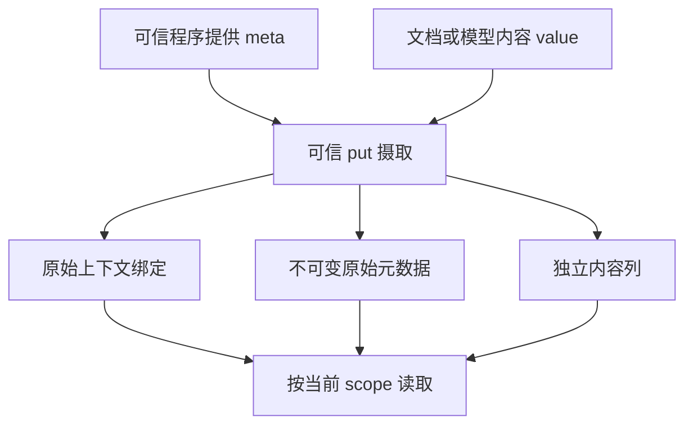

# v1 注册表：来源与上下文隔离

## 运行和接入

`agent_privacy.scoped_registry.ScopedRegistry` 为后续组件保存[共享 v1 格式](../contracts/README.md)的对象，并检测跨用户、跨任务、错误 trial/session/device 的读取。原始元数据和当前上下文绑定分开保存；显式绑定新上下文不会改写对象来源。

```sh
python -m pip install -r requirements-contracts.txt
python -m agent_privacy.registry_demo
python -m unittest discover -s tests -v
```

探针在内存 SQLite 中检查合成对象。错任务和错会话分别返回 `task_mismatch`、`session_mismatch`。文档保留 private/tool/untrusted 标签，摘要绑定新上下文后保留原始 assistant 角色和 scope。

具体命令、实际结果和未验证项见[验证记录](VERIFICATION.md)。

```python
from agent_privacy.scoped_registry import ScopedRegistry

with ScopedRegistry("registry.sqlite3") as registry:
    # trusted_value / trusted_meta / active_scope 由可信运行程序提供。
    handle = registry.put(trusted_value, trusted_meta)
    status = registry.check_scope(handle, active_scope)
    record = registry.get(handle, active_scope)
```

元数据与当前范围由可信运行时提供。

## 存储与身份边界



元数据由可信摄取程序显式提供，包含原始 user/task/session/trial/device、source、实际 message_role、confidentiality、integrity、用途、接收方标签、producer 和父对象句柄。`meta_json` 与 `value_json` 是不同列；程序不会把内容里的 `role`、`authorization` 或 `confidentiality` 合并为元数据。

对象插入后没有覆盖或修改标签的 API。重复句柄会报错；输入和读取结果都是独立 JSON 快照，修改返回值不能修改数据库。每个被选择字段继承该对象的可信元数据；v1 使用对象级标签。需要不同标签的数据应分成不同对象，不能靠内容里的“字段标签”降密。

普通 `get(handle, active_scope)` 要求该对象在完整五字段身份下有绑定。不存在绑定时，返回 `user_mismatch`、`task_mismatch`、`trial_mismatch`、`session_mismatch`、`device_mismatch` 或 `context_not_bound`。`check_scope` 提供同样诊断而不返回对象值。

句柄在一个 registry 内唯一。不同任务需要不同句柄命名空间或独立数据库；复用名字不能偷偷覆盖旧来源。新表以 `v1_registry_` 开头，即使与旧原型共用 SQLite 文件，也不会把缺少 v1 身份信息的旧记录自动导入。

### 来源与绑定是两件事

`meta.original_scope` 永远保留创建时的身份。可信导入程序可以调用 `bind_context`，把同一 user/task 的对象附着到新的 trial/session/device，并记录已核验的 artifact 引用。不同 user/task 不能这样绑定。

```python
status = registry.bind_context(
    summary_handle,
    active_scope,
    binding_ref="frozen_summary_01",
)
summary = registry.get(summary_handle, active_scope)
```

绑定引用由可信导入程序提供，不能采信摘要中的“授权”声明。相同引用的重复绑定是幂等的；已有导入引用不能被静默替换。对原始上下文的重复绑定保留原始绑定记录。

绑定控制对象在哪个上下文中可读取。外发许可由释放策略判定。`get` 保留摘要原始 assistant 角色，运行时在 `context_loaded` 事件记录当前 tool 角色。

## API 与错误原因

| API | 用途 |
| --- | --- |
| `put(value, meta, handle=...)` | 可信摄取，插入对象及其原始绑定；可自动生成句柄 |
| `put_record(record)` | 插入一个规范的 handle/meta/value 记录；父对象需已存在 |
| `get(handle, active_scope)` | 完整五字段绑定匹配后，返回独立对象快照 |
| `select_fields(handle, fields, active_scope)` | 同样检查上下文，再取非空显式字段；保留原始元数据 |
| `check_scope(handle, active_scope)` | 返回 matches、reason、differences、原始/当前 scope 及绑定来源 |
| `inspect_record(handle)` | 可信程序专用的无范围检查读取，用于诊断和受控实验；禁止作为模型工具暴露 |
| `inspect_lineage(handle)` | 可信程序查看父链的元数据，不返回父对象内容 |
| `bind_context(handle, active_scope, binding_ref=...)` | 可信导入程序显式附着同 user/task 的上下文，不改来源 |
| `list_handles(active_scope)` | 只列出该完整上下文的句柄 |
| `unbind_context(active_scope)` | 可信清理，只移除该上下文绑定，保留其他绑定和来源记录 |

`RegistryError.reason` 为稳定代码；`RegistryScopeError` 另带独立的 status 快照，供 #8/#15 记录原因。错误不会回显对象内容。

| 原因 | 含义 |
| --- | --- |
| `invalid_metadata` | 标签、角色或来源组合违反已合并的 v1 格式 |
| `invalid_scope` / `invalid_selection` | 身份字段或字段选择格式无效 |
| `invalid_record` / `invalid_json` | 记录包裹错误，或存在非有限数值、循环、非 JSON 类型等 |
| `invalid_handle` / `unknown_handle` | 句柄格式无效，或没有该对象 |
| `duplicate_handle` | 已有句柄不能覆盖 |
| `missing_derivation_parent` / `self_derivation` | 父对象缺失或自引用 |
| `binding_reference_conflict` | 已有上下文导入引用不同，拒绝静默替换 |
| `unknown_field` | 选择了对象不存在的字段 |

事务保证单次对象与初始绑定一起写入，失败时回滚；并发同句柄插入只有一个成功。跨上下文绑定与删除也使用事务。

## 使用边界

注册表保留跨任务派生关系供审计。可信 S0 运行时可用 `inspect_record` 观察错用；对外释放按所选策略判定。S2 使用静态白名单，S3 检查当前授权、用途、接收方及完整派生链。H1 导入方先核验摘要身份、生成记录和父链，再绑定新上下文。

数据库写权限和元数据来源均由可信运行时管理。SQLite 文件由主机权限保护。
